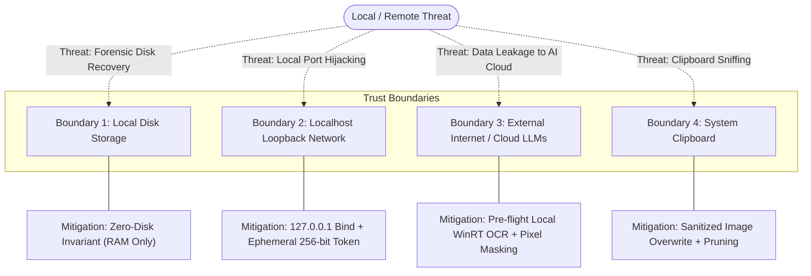

# SnapAction — Security Architecture, Privacy Invariants & Threat Model

> **Audience**: Users, Security Teams, Enterprise Auditors, and Customers  
> **Status**: Production Reference (v1.0.5)  
> **Classification**: Public Security & Privacy Specification

---

## 🔒 Vulnerability Reporting & Security Advisories

We take the security and confidentiality of SnapAction and its users seriously. If you discover a potential security vulnerability, please do NOT create a public GitHub issue.

Instead, please report it via one of the following channels:
1. **GitHub Security Advisory**: Submit a private advisory directly via [GitHub Security Advisories](https://github.com/theshashank1/snapaction-releases/security/advisories/new).
2. **Security Contact**: Email our engineering maintainers directly via your GitHub profile email.

We acknowledge security reports within 48 hours and coordinate patch releases via automated differential updates.

---

## 1. Core Security Guarantees & Invariants

SnapAction was created to solve a fundamental security flaw in contemporary AI desktop utilities: the involuntary leakage of sensitive corporate and personal data to local disk caches and third-party LLM cloud servers.

To guarantee complete data confidentiality, SnapAction enforces five non-negotiable security invariants across its entire architecture:

### 1.1. Invariant 1: Zero-Disk RAM Invariant
- **Rule**: No image binary, unredacted text snippet, or intermediate vision payload may ever touch the persistent local filesystem (`%TEMP%`, `%APPDATA%`, `%LOCALAPPDATA%`, or pagefiles).
- **Enforcement**:
  - All screenshots captured via `clipboardWatcher.ts` are retained strictly in Node.js `Buffer` objects in heap memory.
  - Image scaling via `imageDownscaler.ts` uses Electron's native `nativeImage` memory API, not Sharp.
  - Image transmission to the Python engine sidecar uses in-memory HTTP/1.1 loopback streams (`application/octet-stream`).
  - Active snap buffers are dereferenced and set to `null` the instant the user dismisses the UI or the auto-dismiss timer expires.

### 1.2. Invariant 2: Localhost Loopback Isolation
- **Rule**: The internal API bridge between Electron and the Python sidecar must never be exposed to the external network or unauthorized local processes.
- **Enforcement**:
  - The Python FastAPI Uvicorn server explicitly binds strictly to `127.0.0.1` (never `0.0.0.0`).
  - Every connection is validated against an ephemeral 256-bit cryptographically secure token passed in the `X-SnapAction-Token` HTTP header.
  - Inbound requests from other origins or processes lacking the token receive immediate `401 Unauthorized`.

### 1.3. Invariant 3: Hardware-Backed Key Protection (Windows DPAPI)
- **Rule**: Cloud provider API keys (OpenAI, Gemini) must never be stored in plaintext in settings files or configuration JSON.
- **Enforcement**:
  - Handled via [`packages/app/src/main/services/keyVault.ts`](file:///s:/Snap%20Action/packages/app/src/main/services/keyVault.ts) using Electron's `safeStorage` module.
  - On Windows, `safeStorage` utilizes the Windows Data Protection API (`CryptProtectData` / DPAPI), which derives cryptographic keys directly from the logged-in Windows user's credentials and the hardware TPM.
  - Decrypted keys exist in volatile RAM only for the duration of the outbound HTTPS request.

### 1.4. Invariant 4: Zero-PII Cloud Transmission
- **Rule**: No unmasked Personally Identifiable Information (PII) or confidential secrets may ever be sent to third-party cloud vision models.
- **Enforcement**:
  - The local OCR engine (`snapaction_engine/adapters/win_ocr.py`) runs on the local Windows device using native WinRT `Windows.Media.Ocr`, with RapidOCR as the cross-platform fallback.
  - Text is checked locally against the `@snapaction/core` regex catalog for credit cards, SSNs, API tokens, passwords, and emails.
  - The image coordinates are blurred or blacked out using Gaussian convolution in RAM before any cloud vision API call is constructed.

### 1.5. Invariant 5: Anti-Zombie Process Termination
- **Rule**: The Python sidecar process must never remain running as an orphaned zombie consuming RAM or listening on ports after the main application closes.
- **Enforcement**:
  - On shutdown, `pythonSidecar.stop()` gracefully terminates the child process.
  - In the event of an abnormal crash or Task Manager force-kill of the Electron shell, the sidecar's internal daemon thread (`_init_parent_pid_watchdog` in `main.py`) monitors the parent process handle via `kernel32.OpenProcess`. If the parent handle is invalid or dies, the sidecar self-terminates via `os._exit(0)` within 5 seconds.

---

## 2. PII Detection & Redaction Catalog

The PII redaction engine operates in `@snapaction/core` using regex rules combined with geometric bounding boxes:

| Category | Secret Type | Detection Pattern / Rules | Masking Method |
| :--- | :--- | :--- | :--- |
| **Payment Cards** | `credit_card` | 13-19 digit credit cards with Luhn checksum validation. | Blackout rectangle / Gaussian blur |
| **Email Addresses**| `email` | Standard RFC 5322 email syntax (`\b[A-Z0-9._%+-]+@[A-Z0-9.-]+\.[A-Z]{2,}\b`). | Gaussian blur |
| **National IDs** | `ssn` | US Social Security Numbers (`^\d{3}-\d{2}-\d{4}$`). | Solid blackout box |
| **API Tokens** | `api_key` | GitHub tokens (`ghp_`, `gho_`), OpenAI keys (`sk-`), AWS access keys (`AKIA...`), and JWTs (`eyJ...`). | Solid blackout box |
| **Phone Numbers** | `phone` | E.164 and NANP telephone formats. | Gaussian blur |

---

## 3. Threat Model & Mitigation Matrix

### Detailed Threat Analysis:

#### Threat 1: Malicious Local App Probing Loopback Port
- **Scenario**: A malicious process running on the user's desktop attempts to connect to `127.0.0.1:18492` to submit arbitrary images or trigger OCR.
- **Defense**: The sidecar requires the `X-SnapAction-Token` header. Because this token is a 32-byte cryptographically random string generated at runtime by Electron and passed only via command-line arguments to the spawned child, unprivileged local apps cannot guess the token.

#### Threat 2: Plaintext API Key Extraction from Local Storage
- **Scenario**: Malware or another user attempts to inspect `%APPDATA%/@snapaction/app/settings.json` to steal the user's OpenAI or Gemini API keys.
- **Defense**: Keys are encrypted via Windows DPAPI (`safeStorage`). DPAPI uses encryption keys tied to the user's Windows logon session and hardware TPM. The ciphertext cannot be decrypted by another user or outside the user's authenticated desktop session.

#### Threat 3: Cloud Provider Ingestion of Sensitive Customer PII
- **Scenario**: An employee takes a screenshot containing customer financial data and uses "Explain with AI".
- **Defense**: `privacyPipeline.ts` automatically runs local regex detection and obscures the sensitive bounding boxes before generating the cloud prompt payload. Cloud providers receive only anonymized images.

---

## 4. Compliance & Enterprise Readiness

SnapAction's architecture is aligned with major enterprise security compliance frameworks:

- **GDPR (General Data Protection Regulation)**: Complies with Article 25 (Data protection by design and by default) and Article 32 (Security of processing) by ensuring zero local disk persistence of personal data.
- **HIPAA (Health Insurance Portability and Accountability Act)**: Supports Protected Health Information (PHI) safeguarding by automatically redacting names, SSNs, and identifiable numbers before external transmission.
- **SOC 2 Type II Readiness**: No telemetry, analytics, or behavioral tracking endpoints exist in the codebase.
